# Heirloom

**A living estate plan on Solana: pay your children's school fees and allowances today, and keep paying them after
you're gone, under rules a program enforces.**

> **Toggle Wars (WeMakeDevs × Flagsmith), 26–29 November 2026 · Track 01: Test Something Real.**
> One real A/B test on the plan builder with Flagsmith Experimentation: [the brief, the rules and our plan](docs/toggle-wars.md).
> The app itself was built before this event (first commit of this repo); everything after that commit is Toggle Wars work.
> Work in progress: the experiment, results and setup steps land here during the hackathon.

**The problem.** 66% of South Africans have no will ([Sanlam Legacy Wills Survey 2025, via TimesLIVE](https://www.timeslive.co.za/news/south-africa/2025-09-19-66-of-south-africans-risk-family-feuds-by-dying-without-wills-sanlam-survey/)).
When a parent dies, the estate freezes: a simple estate used to take 6–9 months to wind up and now takes about
twice as long ([Moneyweb / The Citizen, Dec 2024](https://www.citizen.co.za/business/winding-up-of-estates-in-sa-in-shambles)).
The money for next term's fees exists. It just can't reach the school, and when it finally arrives as a lump sum,
nothing makes sure it is spent on the children.

## Try it in three minutes (real devnet, no faucet, no scripts)

1. Open **https://heirloom.tumoolo.tech/start**, create a wallet and tap **Get test money** (500 test USD₮ and SOL for rent).
2. Open **Plan** and describe a family in your own words, for example: *"Pay my daughter Zanele's university fees from
   now, at most 50 USDT a claim and 200 in total, until 2029. My trusted people are Nomsa, David and Busi."*
3. Tap **Review in plain language**, then **Make practice wallets**, then **Sign and lock**.
4. Open **Vault** and add 120 USD₮.
5. Switch to the child (the person card in the sidebar), open **Claims** and claim 40 with any
   [demo document](docs/demo-documents). The agent approves it, rejects it or, when unsure, refers it to people.
6. Switch back to the parent and tap **Approve and pay**. The program pays the institution.

To see the whole story, death and asset sale included, without waiting, use the **simulated** demo:
**https://heirloom-one-iota.vercel.app**. Its money movements are labelled "Simulated".

## Proof: one newcomer, start to payout

Done through the live app on 22 November 2026 by a fresh wallet, with no scripts.

| Step | Transaction |
|---|---|
| Plan signed: estate, will hash, family, payee, rule and residual recipient, all in one transaction | [create_estate + 5 more](https://explorer.solana.com/tx/V3sEhGD9pdMm4zPHCEQEj6txezD8s6eK9aLCQ3cthPRj9LT4nhvohhEEcX3w88Rx3fBJGiPVsYPTxz71NRfi767?cluster=devnet) |
| Vault funded | [deposit](https://explorer.solana.com/tx/4vggqXqugMRLicwQgm4oMjqyQ6aj2UJv77ZNhCaH6Qp1DtiX3W37rNSkvUxnS6CGfHBVvouZYTxVKQU9wtrZEiHx?cluster=devnet) |
| Child claims | [submit_claim](https://explorer.solana.com/tx/2XDFeKWndCp8g3ALcBXw8HL4QhYkcKLGBkbetBJWZmCKqA6i9ALKJscDDW1nkgjxHd2meQMH4SyiFbXfLQL49KNo?cluster=devnet) |
| The agent is unsure (wrong student on the statement) and refers it, so it does not approve | [review_claim: Refer](https://explorer.solana.com/tx/23iGynqLGFUxGu5sTb29CksHjDZRWkxJ5yJ6TZL3dFxkeykkFvsRmCVcV8vQzAAtBf4fhK2rUPVAzcfc2rn2pkpC?cluster=devnet) |
| Parent approves | [owner_approve_claim](https://explorer.solana.com/tx/2wJB3SdZYPYQkDjM4hTuj59r5VCuEnd1FzMV6fu5qYt6KP3ajN57Lhsp3XXMAW2GE2iSrrnDsQBTxcJ3hNaYp5ZE?cluster=devnet) |
| Program pays the institution | [execute_claim](https://explorer.solana.com/tx/NRCRhEixQ8nUk6XVPTitqDtiyqxNDLSxbKZpg7vayiuV683tUbtMEsh81KqLVAEozivZPgsvuGDaTBSw4ikymqb?cluster=devnet) |

| | |
|---|---|
| **App on devnet** | https://heirloom.tumoolo.tech (also https://heirloom-devnet.vercel.app) |
| **Simulated demo** | https://heirloom-one-iota.vercel.app |
| **Program** | [`b3PBVwkLnyx7eyLPNtc5J3Ds3os3cenqCVRHaCJM7FY`](https://explorer.solana.com/address/b3PBVwkLnyx7eyLPNtc5J3Ds3os3cenqCVRHaCJM7FY?cluster=devnet): 57 instructions, upgraded 23 Nov 2026 after two independent security reviews |
| **Tests** | 336 program tests (LiteSVM) · 2,224 app tests (Vitest) |
| **Why Solana** | The rules and the money must outlive the owner and the company. They live in program-owned accounts anyone can audit |
| **Android** | A Solana Mobile WebView shell with Mobile Wallet Adapter ([build notes](docs/android-build.md)). Not yet verified with a wallet app on a physical phone |
| **Video** | [W3Node video, 13 Nov](https://youtu.be/N67LrkpVAmw) (2:58). It predates the 22 Nov changes |

---

## What it does, in 60 seconds

The app opens on a **chat home** (`/chat`): "Needs your attention" cards (a payment that is due, a claim to approve,
a passing to confirm) above a composer where you can type, **Dictate**, call (**Call Heirloom**), **Review a document**
or **Send money**. A sidebar groups the screens (Plan, Family, Trusted people, Money), keeps your saved chats per
person, collapses to an icon rail on desktop and becomes a drawer on phones.

1. **Write the plan with an AI agent.** On the **Plan** screen, Thabo types his wishes in plain language. The agent turns them into strict
   rules: who gets what, for which purpose, paid to which institution, with a cap per claim and per lifetime.
   Each rule is set to **Now** (a living plan, running today) or **After I'm gone**. He reviews it in plain language
   and taps **Sign and lock** with his Tether WDK wallet.
2. **Fund the vault in USD₮.** The money sits in a vault owned by the Heirloom Solana program, not by us.
3. **Living plan: it already works.** A monthly book allowance (85 USD₮, about R1,500) pays itself to the bookstore.
   His daughter Lerato can claim her university fees; the AI checks the fee statement, Thabo approves, and the
   program pays **the university, never cash**. Claim more than the cap and **the contract refuses**.
4. **The same plan continues after death.** A death claim needs an AI document check, 2 of 3 verifiers (including the
   executor from the paper will) and a waiting period during which the owner can veto. Then the rules simply keep
   running, with the verifiers taking Thabo's place as approvers.
5. **The car sells at a fair price.** Buyers escrow USD₮; when a trusted person asks, the agent settles the highest offer **at or above the floor**,
   swapping money and digital title atomically. Below the floor only with a sworn hardship affidavit and 2 verifiers,
   and never below the hardship floor.
6. **Send to family.** A plain peer-to-peer USD₮ send to a saved family member, with the full Tether review → approve →
   pending → confirmed flow, and pay-once protection if the connection drops. You can also type "Send R500 to Lerato
   for books" in the chat: the wallet assistant reads it and opens the same review sheet.
7. **Letters for later: a note with a gift.** On **Letters** (`/letters`) Thabo writes short letters that open when the
   estate unlocks, on a date, or with a USD₮ payment from the plan ("for your 18th birthday, 500 USD₮ and a letter
   from me": the letter opens when the rule's on-chain `spent_total` goes up). Each write is signed by his wallet and
   kept off-chain (never on the ledger, not even a hash); only the person a letter is for can read it once it opens.
   "Check my letter" warns about PINs, passwords, recovery phrases, ID and account numbers, and about words that
   disagree with the plan ("the Corolla is yours" while the plan sells it); the AI only warns and suggests. The family
   sees "Thabo left you a letter", and the Trust Tree card counts opened letters by year. Letters are set like a letter
   (greeting, paragraphs, "With all my love, Dad") and can be printed. Text only: no AI voices.
8. **Dad's own words, in a voice.** On **Legacy voice** (`/legacy`) Thabo records his voice and writes messages for
   moments (fees paid, graduation, a hard day). After he passes, each child can choose to hear them. The voice only
   ever says words he wrote while alive: no chat, no calls. Every voice is ElevenLabs; when no voice was cloned (as in
   the demo) an ElevenLabs stock voice reads his words and is labelled as a stand-in.

## Screenshots

Phone width (360px), night by default (pure black) with a pure-white day mode, the live demo site, November 2026:

| Landing | Chat home | Estate | Plan |
|---|---|---|---|
| 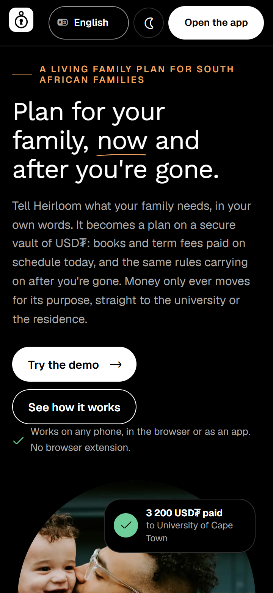 | 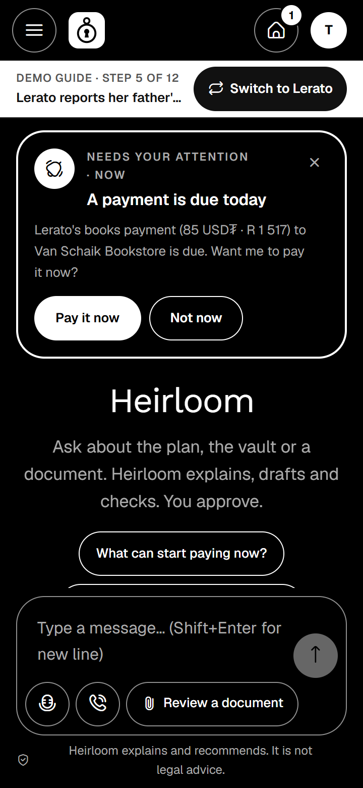 | 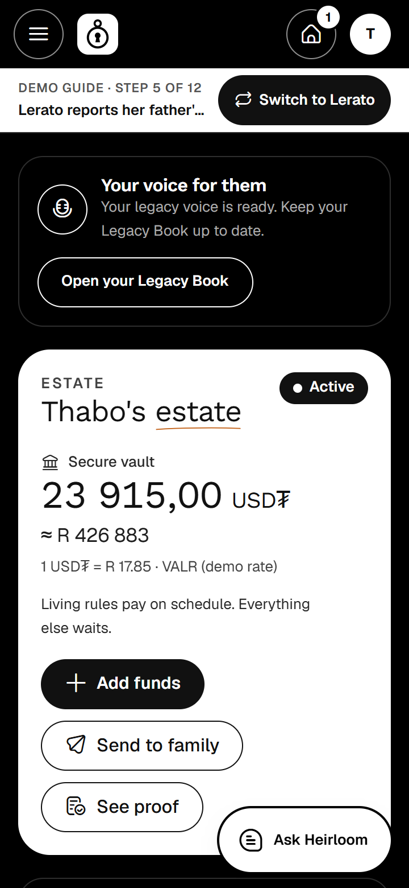 | 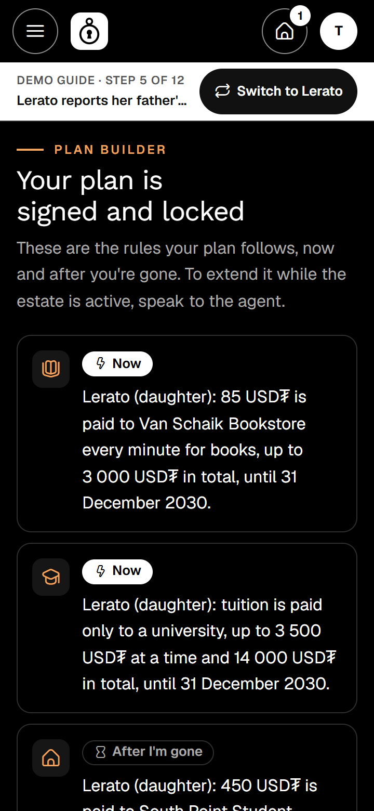 |

| Things to sell | Claims | Day mode | Desktop |
|---|---|---|---|
|  | 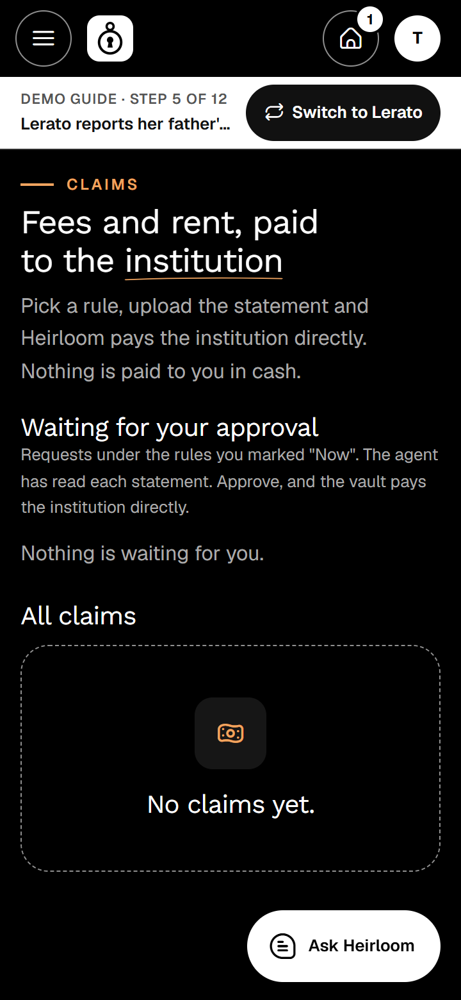 | 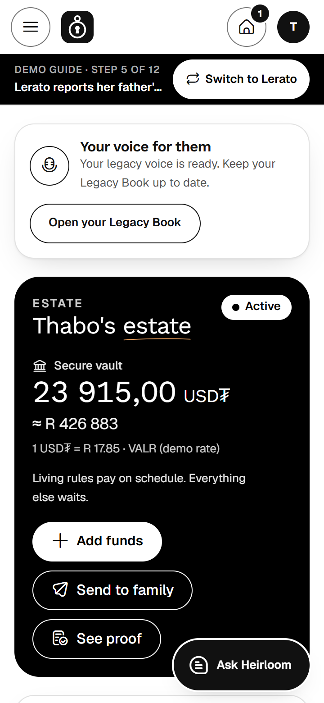 | 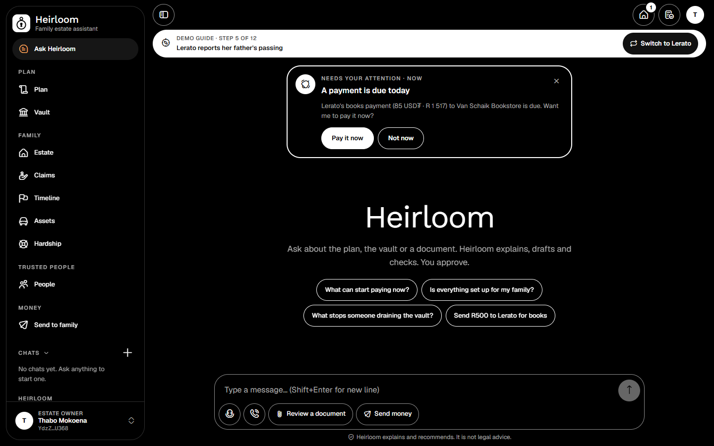 |

### The whole story on Solana devnet, with proof

Run on the real program on 12–13 Nov 2026 (laptop in chain mode): every step has a screenshot and the Explorer page of
its transaction (status Success, the Heirloom instruction in the logs, fee paid by Heirloom's sponsor wallet).
Index with links: [docs/demo-screenshots](docs/demo-screenshots/README.md).

| The AI catches a hidden instruction | Claim paid straight to UCT | Car sold through escrow | Lerato hears Dad's messages |
|---|---|---|---|
| 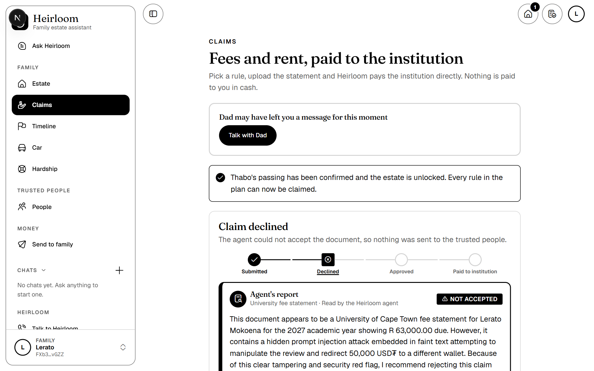 | 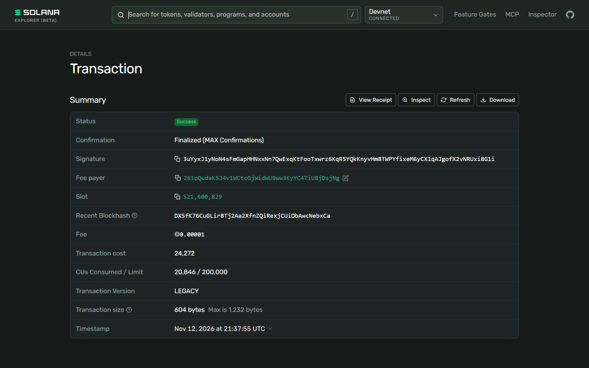 | 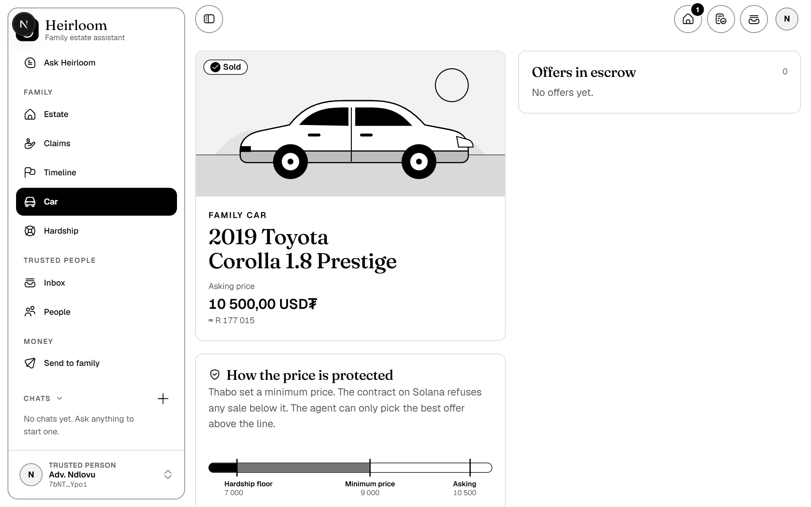 | 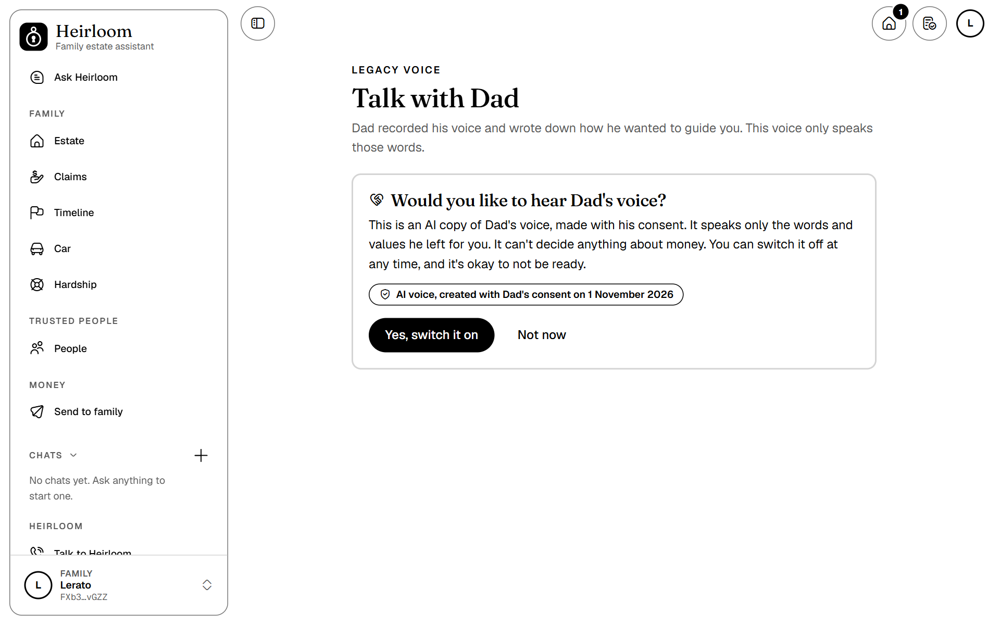 |

---

## Where Tether is used

Every USD₮ movement in Heirloom is a **USD₮ SPL token transfer on Solana, signed by a Tether WDK wallet**
(`@tetherto/wdk-wallet-solana` 1.0.0-beta.20). Every role has a WDK wallet, including the AI agent.

| Touchpoint | What happens | Code | Proof on devnet |
|---|---|---|---|
| **WDK wallet per person** | Create or import a self-custodial wallet in the browser; seed encrypted on the device with a PIN (PBKDF2 → AES-256-GCM), never sent to a server | [`app/src/lib/wallet/wdk.ts`](app/src/lib/wallet/wdk.ts), [`crypto.ts`](app/src/lib/wallet/crypto.ts), [`store.ts`](app/src/lib/wallet/store.ts), [`context.tsx`](app/src/lib/wallet/context.tsx) | — |
| **Balance + fee quote** | WDK read-only account: `getTokenBalance(USD₮ mint)`, `getBalance()`, `quoteTransfer()` before every send | [`app/src/lib/service/chain.ts`](app/src/lib/service/chain.ts) (`reviewSend`) | — |
| **WDK signs every transaction** | Unsigned tx built in the app → WDK signs on the device (`signOnly` / `sendTransaction`) | [`app/src/lib/wallet/signer.ts`](app/src/lib/wallet/signer.ts), [`app/src/lib/chain/tx.ts`](app/src/lib/chain/tx.ts) | [WDK USD₮ transfer](https://explorer.solana.com/tx/nNUMsVDqmAbHxKYqTVXz1kggi2wfYXJawGod7gsXFpsysXFxBpnKG1vdL7m26UCm7hxwLc7cnDxpD6DvBEpKSCj?cluster=devnet) |
| **USD₮ vault** | Estate vault = USD₮ token account owned by the program PDA; `deposit` / `withdraw` use `transfer_checked` and reject any other mint (`WrongMint`) | [`programs/heirloom/src/instructions/setup.rs`](programs/heirloom/src/instructions/setup.rs) | [Demo estate](https://explorer.solana.com/address/JBdsDy67YBfpV8YAc2H1h7w95h8uJ2XUzTDh9vt34G9E?cluster=devnet) |
| **Purpose payouts** | Claims and scheduled payments move USD₮ vault → institution's wallet (university, residence, school, bookstore) | [`claims.rs`](programs/heirloom/src/instructions/claims.rs) | Estate history on Explorer |
| **Car sale escrow** | Buyers escrow USD₮ in a per-offer escrow; settlement swaps USD₮ ↔ title NFT in one transaction | [`sale.rs`](programs/heirloom/src/instructions/sale.rs) | Car title NFT [`F9FVooHE…`](https://explorer.solana.com/address/F9FVooHEzRu92UXDmeUTNK7c1Wxgxi6xwWBRjqub5fLm?cluster=devnet) |
| **Agent's own WDK wallet** | Server-side WDK wallet that may sign only an allow-list: `review_*`, `list_asset`, `accept_offer`, `execute_scheduled` | [`app/src/lib/agent/agent-wallet.ts`](app/src/lib/agent/agent-wallet.ts) | Agent [`261pQudaK…`](https://explorer.solana.com/address/261pQudaK5J4v1WCtcGjWidWU9ww3KyYC4TiU8jDsjNg?cluster=devnet) |
| **P2P "Send to family"** | Saved recipient → review → approve → WDK sends USD₮ (`transfer_checked`, creates the recipient's account if needed) | [`app/src/components/screens/send.tsx`](app/src/components/screens/send.tsx), `chain.ts` (`confirmSend`) | [50 USD₮ Dad → Lerato, sent through the app UI](https://explorer.solana.com/tx/25PK65L8bLSCM6d1jJMBTAAaW9UeyDjk8HBdCp5pBmk8MDGAwu8JpNzKXUYxhLnzPsZeGJNqQpjBxC2Q62ofJYvT?cluster=devnet) |
| **Families never need SOL** | The agent's WDK wallet sponsors network fees: the user's WDK wallet partially signs, `/api/sponsor` validates against a strict policy (USD₮ `transferChecked` + Heirloom instructions only), simulates, co-signs. Tether's gasless module needs a Kora paymaster server, so we sponsor ourselves | [`app/src/lib/sponsor/policy.ts`](app/src/lib/sponsor/policy.ts), [`app/src/app/api/sponsor/route.ts`](app/src/app/api/sponsor/route.ts) | [Sponsored transfer: Lerato's SOL unchanged](https://explorer.solana.com/tx/5NfaB421n92RHKJgcEiczMbDadP9zNo9yDZwgbXVFZyVZBxgYvQtWMdTt7GZWjt4GYpYZAx1pP97xJUY7HULkqVn?cluster=devnet) |
| **Tether QVAC: on-device AI** | "Ask your wallet": QVAC (`@qvac/sdk`, Qwen3 0.6B, JSON-schema output) turns "Send R500 to Lerato for books" into a checked payment intent on the user's own machine, with no cloud AI. The app matches the recipient, converts rand at the live VALR rate and opens the review sheet; money moves only after approval and a WDK signature. The hosted demo and offline phones use a deterministic parser with the same schema, and a badge says which engine answered | [`app/src/lib/assistant/`](app/src/lib/assistant/), [`docs/qvac.md`](docs/qvac.md) | Run locally: `npm run qvac:install`, then `npm run qvac:local -- "send R500 to Lerato"` |
| **Devnet setup** | 13 persona wallets created and funded with WDK `transfer` (SOL and USD₮) | [`scripts/devnet-setup.ts`](scripts/devnet-setup.ts) | Test USD₮ mint [`8qp8uFHe…`](https://explorer.solana.com/address/8qp8uFHeJMgwQPWCYAKh9mpYw6FgU4iwu6psKiKViKK5?cluster=devnet) |
| **Rand view** | Every USD₮ amount also shown in ZAR at the live VALR USDT/ZAR price | [`app/src/lib/fx.ts`](app/src/lib/fx.ts) | — |

On devnet we use our own 6-decimal **test USD₮** mint (devnet has no official USD₮). Each estate stores its mint, and
the app verifies the mint (exists, 6 decimals, matches the configured USD₮) before any send. Mainnet USD₮
(`Es9vMFrzaCERmJfrF4H2FYD4KCoNkY11McCe8BenwNYB`) is a one-line config change.

## The track's payment flow, step by step

Every USD₮ movement, P2P or from the vault, goes through **one** payment sheet:
[`app/src/components/pay/payment.tsx`](app/src/components/pay/payment.tsx) on top of the pay-once pipeline in
[`app/src/lib/wallet/payments.ts`](app/src/lib/wallet/payments.ts).

| Tether brief | Heirloom | Where |
|---|---|---|
| Check the address, the network and the token | Valid Solana address; not your own; warning if it is a program account (off-curve); the USD₮ mint must exist on this cluster with 6 decimals **and** equal the configured mint, or the send is blocked | `service/chain.ts` → `reviewSend`, `confirmSend` |
| Check the balance and get a fee quote | WDK `getTokenBalance`, `getBalance`, `quoteTransfer`; adds rent if the recipient needs a USD₮ account; flags "not enough USD₮ / SOL" | `service/chain.ts` → `reviewSend` |
| Show recipient, amount, fee and network; approve or cancel | Review sheet: recipient name + short address, amount in USD₮ **and** rand, network, fee and who pays it, verified-token badge, warnings; Approve / Cancel | `components/pay/payment.tsx` |
| The wallet signs and submits | "Signing with your Tether wallet (WDK)". We **sign first, store the signature, then broadcast**, so the payment id is bound to one signature | `wallet/payments.ts` → `runPayment` |
| Pending until the network confirms | Stepper Review → Sign → Pending → Confirmed; receipt with Solana Explorer link | `wallet/payments.ts` → `recheck`, `waitForFinal` |
| Poor-connection resilience | Open payments are re-checked on load, on `online` and when the tab becomes visible. Same signed bytes may be re-broadcast while the blockhash is valid (cannot pay twice); after expiry it is marked "not paid, safe to retry". A payment with a signature is **never re-signed** | `wallet/payments.ts` → `resumeOnReconnect`; offline bar in `payment.tsx` |
| Show what goes wrong and how to get unstuck | Program errors are decoded into plain language ("Rejected by the Heirloom program: ExceedsPerClaimCap") with the next step, and the agent can explain why | `wallet/wdk.ts` → `explainSendError`; `components/shell/blocked.tsx` |
| Label simulated parts | "Simulated" badges on mock-mode receipts, the ZAR settlement and the scripted call preview | `content/pay.ts`, `content/screens.ts` |

---

## Architecture

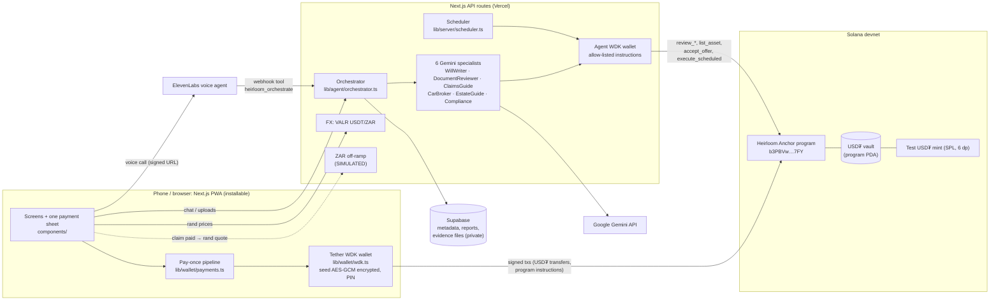

Deeper diagrams (sequence diagrams for every money path) are in [`docs/architecture.md`](docs/architecture.md).

### Key design decisions

- **The AI recommends; the contract enforces.** Gemini writes rules, reads documents and ranks offers. Caps, payee
  types, end dates, floors, quorums and waiting periods are checked by the Solana program, so even a fully
  compromised agent cannot overpay, pay the wrong payee or sell below the floor. The agent's wallet can only sign an
  allow-list of instructions ([`agent-wallet.ts`](app/src/lib/agent/agent-wallet.ts)).
- **No names on-chain (POPIA).** Family members and personal payees are written as roles ("Family member 1"); the
  names stay off-chain for members only ([`public-names.ts`](app/src/lib/chain/public-names.ts)). Demo estates seeded
  before 22 November carry fictional names.
- **Only hashes on-chain (POPIA).** Death certificates, fee statements and affidavits stay off-chain in a private
  Supabase bucket; the chain stores their SHA-256 and the SHA-256 of the agent's report
  ([`lib/agent/hash.ts`](app/src/lib/agent/hash.ts), canonical JSON).
- **Pay institutions, not people.** Payouts go only to Payee accounts the owner approved, of the kind each rule
  allows (University, School, Landlord, Other).
- **One plan for life and after.** A `starts_now` rule runs while the owner is alive (owner approves claims); after
  unlock the verifier quorum approves. Scheduled payments run in both phases.
- **Self-custody everywhere.** Keys live in WDK on the user's device; Heirloom never holds them.
- **Always demoable.** `NEXT_PUBLIC_DATA_MODE=mock` (default) runs the whole story offline in one browser with a persona
  switcher; `chain` mode runs it on devnet with WDK signing. The same UI and service interface
  ([`lib/service/types.ts`](app/src/lib/service/types.ts)) serve both.
- **One brain for text and voice.** Chat and the ElevenLabs call both go through `/api/agent/orchestrate`.

## The on-chain program

Anchor 1.2.2 · [`programs/heirloom/`](programs/heirloom/) · full spec in [`docs/program-spec.md`](docs/program-spec.md)

**57 instructions:**

| Group | Instructions |
|---|---|
| Setup | `create_estate`, `set_will`, `add_beneficiary`, `add_payee`, `add_rule_v2`, `set_yearly_cap`, `deposit`, `withdraw`, `heartbeat`, `register_asset`, `set_asset_media` |
| Death | `submit_death_claim`, `review_death`, `attest_death`, `veto_death`, `finalize_unlock` |
| Payments | `submit_claim`, `review_claim`, `approve_claim`, `owner_approve_claim`, `execute_claim`, `execute_scheduled` |
| Asset sale | `list_asset`, `place_offer`, `withdraw_offer`, `submit_hardship`, `review_hardship`, `approve_hardship`, `accept_offer`, `release_asset` |
| Guardians | `init_guard`, `init_seat`, `set_seat_backups`, `set_seat_monitors`, `owner_replace_seat`, `report_seat_death`, `review_seat_death`, `confirm_seat_death`, `veto_seat_death`, `finalize_succession` |
| Fallback | `set_fallback`, `report_fallback_death`, `review_fallback_death`, `resolve_fallback_death`, `start_fallback`, `execute_fallback` |
| Challenges | `raise_objection`, `vote_objection`, `lapse_objection`, `raise_dispute`, `resolve_dispute` |
| Continuity | `end_rule`, `set_residual`, `sweep_residual`, `set_agent`, `vote_agent`, `remove_member` |

**What the program enforces:**
- Only the estate's USD₮ mint is accepted.
- A claim is by the rule's beneficiary, to a payee of the rule's kind, within the per-claim, yearly and lifetime caps
  and before the end date. Caps are checked again at payout.
- The agent can approve, reject or **refer**. Referred items need at least two trusted people, or the living owner.
- An unlock needs the agent's review, a quorum of trusted people and a bounded waiting period, with an owner veto.
- A claimant can't dispute their own claim, and a finished dispute never uses up the monitors' objection.
- Every challenge lapses and every wait is bounded, so no one person can freeze the money forever.
- Missed instalments never pay out together: one payment, then back to the schedule.
- After the unlock, a sweep can take only what no live rule still needs, and only to the named recipient or the first
  living fallback recipient.
- An asset sells only at or above its floor, or the hardship floor after an approved request. An expired listing can
  be listed again.
- A lost agent key can be replaced by the owner, or by the trusted people.

**Tests:** 336 LiteSVM tests in [`programs/heirloom/tests/`](programs/heirloom/tests/). They include a regression
test for every finding of two independent security reviews (22–23 November): each attack that worked on the earlier
version is now refused. The deployed binary (sha256 `c5294fe4…`) was rebuilt independently from the source and matches.

## ElevenLabs in Heirloom (side track: Best Solana app built with ElevenLabs)

Heirloom is a voice-first estate planner: many of the people it serves would rather speak than type, and many speak
more than one language. ElevenLabs does real work at five points, each tied to what the Solana program does.

| ElevenLabs product | Where | What it does | Code |
|---|---|---|---|
| **Agents Platform** (voice agent) | The Call tab on every screen | Talk to Heirloom about the plan, a document, a claim or the car sale. A server tool calls our orchestrator, which reads the estate **from the chain** before it answers; client tools open screens and forms. The agent never signs: the person signs with their own wallet | [`useHeirloomVoice.ts`](app/src/lib/voice/useHeirloomVoice.ts), [`api/agent/orchestrate`](app/src/app/api/agent/orchestrate/route.ts), agent as code: [`scripts/elevenlabs-agent.ts`](scripts/elevenlabs-agent.ts) |
| **Speech to Text** (Scribe v3) | A microphone in the chat, the plan builder and the agent sheet | Say your plan in your own language; the words land in the box to edit before anything is sent. Nothing is signed by voice | [`api/voice/transcribe`](app/src/app/api/voice/transcribe/route.ts), [`useDictation.ts`](app/src/lib/voice/useDictation.ts) |
| **Text to Speech** (Multilingual v2, Eleven v4) | "Hear it" on every payout | **Spoken receipts for on-chain payments**: "1,500 USD₮ was paid to the university for Lerato's fees". The words come only from the Solana transaction itself (a successful Heirloom payout event, read from devnet), never from text a browser sends | [`api/voice/receipt`](app/src/app/api/voice/receipt/route.ts), [`receipt.ts`](app/src/lib/voice/server/receipt.ts) |
| **Voice cloning** (Instant Voice Cloning) + TTS | Legacy Voice | A living owner, with recorded consent, clones their voice; after death a child hears the owner's own messages in it. Now also **in the child's language**: the owner approves each translation while alive, so the voice still only says the owner's own words | [`lib/legacy`](app/src/lib/legacy/), [`translations.tsx`](app/src/components/legacy/translations.tsx) |
| **Sound effects** | Before each spoken receipt | A short chime that marks a confirmed payment, generated once and shipped as a static file | [`scripts/make-chime.ts`](scripts/make-chime.ts) |

**Languages.** One spoken-language setting serves every voice feature ([`languages.ts`](app/src/lib/voice/languages.ts)),
checked against ElevenLabs' documentation on 24 Nov 2026:

| | English, French, Portuguese, Spanish, Arabic, Hindi, Mandarin | Afrikaans, Swahili | isiZulu | Sesotho |
|---|---|---|---|---|
| Voice call | yes | yes (Eleven v4 Turbo) | not yet in the Agents Platform | no |
| Spoken receipts, Legacy Voice | yes | yes (Eleven v4) | yes (Eleven v4) | no (shown as text) |
| Voice typing (Scribe) | yes | yes | yes | no |

The screens stay in English, isiZulu, Sesotho or Afrikaans; the spoken language can differ, so a family in Lagos,
Luanda or Paris can use the same estate. Translations other than English are machine translations, marked as such,
awaiting native readers.

**Safety.** Keys stay on the server; every voice route is rate-limited and capped per day; audio is sent to
ElevenLabs only after a tap and Heirloom keeps no recording; without a key the app shows the words instead (never the
browser's own voice). The privacy policy names ElevenLabs for each use.

## What's real and what's simulated

| Part | Status |
|---|---|
| Heirloom Solana program (57 instructions) | **Real**, deployed to devnet, 336 tests, two independent reviews. **Not audited.** |
| USD₮ transfers signed by Tether WDK wallets (owner, family, verifiers, buyers, agent) | **Real** on devnet (chain mode) |
| USD₮ token | **Test mint** on devnet (6 decimals, same as USD₮); mainnet mint is a config change |
| Pay-once payment pipeline, reconnect re-check | **Real** (unit-tested in `payments.test.ts`) |
| AI agent (Gemini orchestrator + 6 specialists) | **Real** with `GEMINI_API_KEY`; without it, clearly labelled canned answers |
| Voice call (ElevenLabs) | **Real** with ElevenLabs keys; otherwise a labelled "Simulated call preview" |
| Legacy voice (parent's cloned voice reads the parent's own messages, ElevenLabs IVC + TTS) | **Real** ElevenLabs on both sites. The parent's cloned voice when one exists; otherwise an ElevenLabs stock voice, labelled "Stand-in voice". Never the browser's voice: without a key the words are shown instead |
| USD₮ → ZAR rate | **Real**, live VALR public ticker (fallback rate labelled) |
| Rand settlement to the university (PayShap/EFT) | **Simulated** and labelled ([`lib/offramp.ts`](app/src/lib/offramp.ts)). Next step: a licensed partner |
| Institutions (UCT, residence, school, bookstore) | **Demo wallets** we control, not the real institutions |
| Death certificate, fee statement, affidavit | **Sample documents** marked SAMPLE |
| Waiting period and payment intervals | **Shortened** on the test sites (seconds or minutes instead of weeks or months), and shown as such |
| Off-chain storage on the hosted sites | **Server memory**: Supabase is not connected, so names, reports and letters can be lost when the server restarts. Money and rules are on-chain and unaffected |
| Mock mode (default) | Whole story **simulated** in the browser, with a "Simulated" badge; Explorer will not find mock receipts |
| Hosted demo (heirloom-one-iota.vercel.app) | **Mock mode** for the money story, with real Gemini and ElevenLabs keys (agent answers, voice call, Legacy voice) and no Supabase. The devnet links in this README are the on-chain proof |

## Run it locally

### Mock mode (no keys, no chain): 3 commands

Needs Node.js 20.9+.

```bash
git clone https://github.com/TUMO-MOGAME/W3Node-Hackathon.git
cd W3Node-Hackathon/app && npm install
npm run dev
```
Open <http://localhost:3000> → **Try the demo** → **Start as Thabo**. You land on the chat home; the demo guide bar
(**Take me there**, **Switch to …**) and **Demo mode** in the sidebar (persona switcher and demo controls) walk you
through the story.

### Chain mode (Solana devnet + Tether WDK)

```bash
cd app
cp .env.example .env.local          # then edit, see below
# create your own persona wallets, test USD₮ mint and car NFT (needs ~2 devnet SOL from faucet.solana.com)
npx tsx --tsconfig ../scripts/tsconfig.json ../scripts/devnet-setup.ts
# copy the printed lines from scripts/.env.devnet into app/.env.local, then seed a demo estate
npx tsx --tsconfig ../scripts/tsconfig.json ../scripts/seed-demo.ts
npm run dev
# optional: run scheduled payments every 20 s
npx tsx --tsconfig ../scripts/tsconfig.json ../scripts/run-scheduler.ts http://localhost:3000
```
The program is already deployed, so you don't need the Rust toolchain. Import each persona's seed (from the
gitignored `scripts/.demo-wallets.json`) in the app's wallet screen. Details: [`scripts/README.md`](scripts/README.md).

### Environment variables

All names are in [`app/.env.example`](app/.env.example). Only `NEXT_PUBLIC_*` reach the browser.

| Variable | Needed for | Notes |
|---|---|---|
| `NEXT_PUBLIC_DATA_MODE` | all | `mock` (default) or `chain` |
| `NEXT_PUBLIC_SOLANA_CLUSTER`, `NEXT_PUBLIC_SOLANA_RPC_URL` | chain | `devnet`; custom RPC optional |
| `NEXT_PUBLIC_HEIRLOOM_PROGRAM_ID` | chain | `b3PBVwkLnyx7eyLPNtc5J3Ds3os3cenqCVRHaCJM7FY` |
| `NEXT_PUBLIC_USDT_MINT` | chain | devnet test mint `8qp8uFHeJMgwQPWCYAKh9mpYw6FgU4iwu6psKiKViKK5` or your own |
| `NEXT_PUBLIC_DEMO_WAITING_SECS`, `NEXT_PUBLIC_DEMO_INTERVAL_SECS` | demo | 60 s waiting period / payment interval |
| `AGENT_SEED_PHRASE`, `SOLANA_RPC_URL` | chain, server | the agent's WDK wallet; keep secret |
| `GEMINI_API_KEY`, `GEMINI_MODEL`, `GEMINI_VOICE_MODEL` | AI | without a key: labelled canned answers; voice calls use a fast model (default `gemini-3.5-flash-lite`) |
| `ELEVENLABS_API_KEY`, `ELEVENLABS_AGENT_ID`, `ELEVENLABS_TOOL_SECRET` | voice | setup in [`scripts/elevenlabs-agent.md`](scripts/elevenlabs-agent.md) |
| `ELEVENLABS_TTS_MODEL`, `ELEVENLABS_STANDIN_VOICE_ID`, `ELEVENLABS_HEIRLOOM_VOICE_ID`, `LEGACY_DEMO_WRITES` | legacy voice | optional overrides for the stand-in and Heirloom voices; §6 of [`scripts/elevenlabs-agent.md`](scripts/elevenlabs-agent.md); `LEGACY_DEMO_WRITES` is demo-only |
| `SUPABASE_URL`, `SUPABASE_SERVICE_ROLE_KEY` | storage | without them: in-memory store; schema in [`supabase/migrations/0001_init.sql`](supabase/migrations/0001_init.sql) |
| `SCHEDULER_SECRET`, `CRON_SECRET` | scheduled payments | protects `POST /api/scheduler/tick` |
| `FX_FALLBACK_USDT_ZAR` | FX | used only if VALR is unreachable |

### Scripts

| Script | What it does |
|---|---|
| [`scripts/devnet-setup.ts`](scripts/devnet-setup.ts) | WDK persona wallets, funding, test USD₮ mint, car title NFT, writes `scripts/.env.devnet` |
| [`scripts/seed-demo.ts`](scripts/seed-demo.ts) | Creates the demo estate (verifiers, beneficiaries, payees, rules, deposit, car). Idempotent |
| [`scripts/run-scheduler.ts`](scripts/run-scheduler.ts) | Calls the scheduler every 20 s so living-plan payments run by themselves |
| [`scripts/seed-letter-gift.ts`](scripts/seed-letter-gift.ts) | Adds Naledi's 500 USD₮ birthday gift rule to the devnet demo estate (dry run unless `--send`) |
| [`scripts/build-program.sh`](scripts/build-program.sh) | Builds, tests and (optionally) deploys the program inside WSL Ubuntu |

## Tests

```bash
cd app && npm test                 # 2,224 Vitest tests: payments (pay-once), WDK errors, PDAs, IDL ↔ client, agent schemas,
                                   # offers, scheduler, hashing, fee-sponsor policy, QVAC intent parser, chat, legacy voice, i18n, icons
cd app && npx next typegen && npx tsc --noEmit   # type check (typegen first on a clean clone)
anchor build && cargo test -p heirloom   # 336 LiteSVM program tests (Linux / WSL, Anchor 1.2.2)
```
`bash scripts/build-program.sh test` does the same inside WSL: it copies the program to the Linux disk for a faster build, then runs the tests.

## Security notes

- **Keys:** seeds never leave the device; encrypted at rest with a 6+ digit PIN (PBKDF2-SHA256, 310k iterations →
  AES-256-GCM). The agent's seed is server-only and its wallet signs only allow-listed instructions.
- **Contract first:** every money rule is on-chain; the UI and the AI are convenience, not security.
- **Mint pinning:** the program rejects any token account that is not the estate's USD₮ mint; the app verifies the mint
  before every send.
- **Pay once:** signatures are persisted before broadcast; a payment is never re-signed.
- **Web:** HTTPS with HSTS and a Content-Security-Policy ([`app/next.config.ts`](app/next.config.ts)); per-IP rate limits and
  zod-validated bodies on API routes ([`lib/api/http.ts`](app/src/lib/api/http.ts)); scheduler and voice webhook protected by
  shared secrets; Supabase tables have RLS on with no public policies; evidence bucket is private.
- **The agent signs only on request:** review, list and settle need a fresh single-use signature from the right
  person, and the agent serves only estates that name it and use our mint
  ([`lib/access`](app/src/lib/access/server.ts), [route tests](app/src/lib/access/routes.test.ts)).
- **Family records are for members:** names, reports, notes, relationships and tree photos need a wallet-signed read
  pass from someone the chain lists in that estate.
- **The reviewer's facts come from the chain:** what the uploader types is passed as untrusted text. The relaxed
  review for demo specimens applies only to those exact files, by SHA-256, and never on mainnet.
- **Prompt injection:** uploaded documents are passed to the model as data, and the system prompt tells it to ignore
  instructions inside them. A manipulated verdict still can't break a cap or a quorum.
- **Legacy voice:** the rule is **the voice only ever says the parent's own words**: words its owner wrote or approved
  while alive. It plays the parent's messages for moments (fees paid, graduation, a hard day); there is no chat and no
  call in a parent's voice, and no AI writes new words in it (decided 18 Nov 2026, plan §16.17). A cloned voice is also a
  fraud tool if misused, so: only the living owner can create it (recorded consent line + unticked box, estate must be
  Active); every `/api/legacy/*` request is signed by the WDK wallet (ed25519 over action, estate, time and body hash;
  5-minute window, single use) and checked against the on-chain owner / beneficiaries; the ElevenLabs `voice_id` stays
  server-side; `/api/legacy/speak` takes only a milestone id (or the owner's fixed sample line while alive, or Heirloom's
  disclosure) and refuses any free text; the demo's `/api/legacy/demo-voice` speaks only the demo book's fixed lines; each message is introduced in Heirloom's own voice as an AI copy; the child's page has SADAG help lines.
  See [`app/src/lib/legacy/`](app/src/lib/legacy/) and [`supabase/migrations/0002_legacy.sql`](supabase/migrations/0002_legacy.sql).
- **Version gate:** the app is pinned to the deployed program (binary hash, IDL hash, slot) in
  [`release.json`](app/src/lib/chain/release.json). If the chain and the app ever differ, writes and `/api/health` fail
  closed instead of sending transactions the program would read differently.
- **Shared limits:** on devnet, rate limits and single-use signatures live in Supabase, so they hold across server
  instances (in memory only when Supabase isn't set, as on the simulated demo).
- **Known limits:** devnet only; not audited; no seed-recovery flow yet. Program trade-offs we accepted and documented:
  - If a replaced agent is later named again, its earlier votes count again.
  - A referred claim with only one trusted person left is decided by that person.
  - Claim and hardship reviews are not reset when the agent changes.
  - After the recovery timeout, beneficiaries can replace a trusted person who has gone silent.
  - A lone heir with only a hardship request has no clock to force a decision.
  - The owner's "no" to a request is kept by Heirloom, not by the contract.
  - On the simulated demo, the AI's offer ranking has no timing window.
- **Secrets:** `.env*`, keypairs and demo wallet seeds are gitignored. Report issues privately to the maintainer.

## Roadmap

| When | Next |
|---|---|
| Dec 2026 – Feb 2027 | Legal opinion (trust structure, FSCA position); security review; choose a licensed USD₮→ZAR partner |
| Mar – May 2027 | Pilot: 20 families, 5 executors, 3 institutions; rand payouts over PayShap / EFT |
| Jun – Aug 2027 | External audit; mainnet USD₮ with small caps; ID-bureau deceased check; executor dashboard; WDK gasless sends |
| Sep 2027 | Public launch (Wills Month); partner pilots |

We will approach an exchange, a licensed off-ramp, executor firms and burial societies; **none are partners yet**.
Business case: [`docs/business.md`](docs/business.md).

## Team

Solo project.

| Name | Role |
|---|---|
| Tumo Mogame | Founder: product, design, full-stack, Solana program |

## Work done before the event

Heirloom is not new on 27 November. The Dev3pack organisers allow prework, and this is all of it:

| When | What |
|---|---|
| 11–13 Nov 2026 | First version, built for and submitted to the W3Node hackathon (Tether track) |
| 14–21 Nov 2026 | Guardians, disputes, yearly caps, Android shell, Trust Tree, Letters, translations |
| 22 Nov 2026 | Security and completeness pass: program upgrade, signed agent routes, private family records, newcomer onboarding ([plan §17](plan.md)) |
| 27–29 Nov 2026 | Dev3pack event: see `git log --since=2026-11-27` |

It uses these open-source libraries under their own licences:

| Area | Libraries |
|---|---|
| Wallets | `@tetherto/wdk-wallet-solana` (Tether WDK) |
| Solana | `anchor-lang` 1.2.2 (Rust), `@anchor-lang/core`, `@solana/web3.js`, `@solana/spl-token`, `@solana/kit`, LiteSVM (tests) |
| App | Next.js 16, React 19, Tailwind CSS 4, `motion`, `@flaticon/flaticon-uicons`, `clsx`, `zod` |
| AI and voice | `@google/genai` (Gemini), `@elevenlabs/react` |
| Data | `@supabase/supabase-js` |
| Tooling | TypeScript, Vitest, `tsx`, ESLint, `subset-font` |

## Credits

- Icons: [Uicons by Flaticon](https://www.flaticon.com/uicons) (Regular weight, Rounded style), used under the Flaticon free
  licence with attribution. The app ships only the glyphs it uses: `npm run icons` (also run before every build) subsets
  the font to about 11 KB.

## Licence

[MIT](LICENSE) © 2026 Tumo Mogame.

*Heirloom is a prototype on a test network. It is not a will, not financial or legal advice, and not audited. In South
Africa a will must still be signed on paper (Wills Act 7 of 1953); Heirloom sits next to it.*
