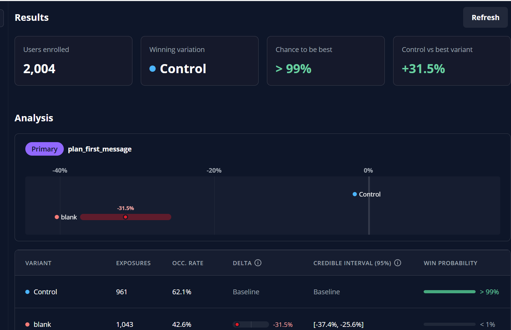

# Heirloom × Flagsmith: do worked examples help people start a will?

**One pre-registered A/B test on a real estate planner: does showing worked examples help more people write the first
sentence of their plan?**

Toggle Wars (WeMakeDevs × Flagsmith), 26–29 November 2026 · **Track 01: Test Something Real**

<!-- TODO: badges for the track, the live site (/try) and the video, once they exist. -->

> **Prior work, up front.** Heirloom, the app under test, was built before this event. The first commit of this repo
> (`3461429`) is Heirloom as it was before Toggle Wars. The later "Bring in Heirloom" commits (`eaa5ba6`, `c6d6725`)
> are also Heirloom's own work, copied in from its own repo, not new work. See [Prior work](#prior-work-honestly).

## The result

**Interim, Fri 27 Nov 16:12 SAST.** The Production experiment stops at the pre-registered time, Sat 28 Nov 14:00
SAST. Full write-up: [docs/results.md](docs/results.md).

| Experiment | Headline | Decision (against the [pre-registered rule](docs/preregistration.md#decision-rule)) |
|---|---|---|
| A/A check (pipeline fairness, **simulated**) | 400 of 400 counted, split 213 / 187, no false winner (interval −16% to +23%) | Passed: the pipeline is fair |
| Simulation (**simulated** visitors) | 2,004 visitors. With examples 62.1% wrote a first message, blank 42.6%: blank −31.5% (95% interval −37.4% to −25.6%). Control > 99% best | Keep `control`. All four effects built into the simulator fall inside Flagsmith's intervals |
| Production (real visitors) | Collecting data (1 visitor at the interim) | Decided at the stop |



*Flagsmith's results page for the Simulation experiment (simulated visitors, 27 Nov 14:12 UTC).*

## The problem

66% of South Africans have no will
([Sanlam Legacy Wills Survey 2025, via TimesLIVE](https://www.timeslive.co.za/news/south-africa/2025-09-19-66-of-south-africans-risk-family-feuds-by-dying-without-wills-sanlam-survey/)).
Heirloom lets a parent describe, in their own words, who should be looked after, and turns that into rules a
Solana program enforces. The hardest step is the first sentence: people don't know how to describe an estate plan.

## The experiment

The full pre-registration, frozen at the `prereg` tag, is in [docs/preregistration.md](docs/preregistration.md).

- **Question:** does showing worked examples on the plan builder help more people send their first message?
- **Hypothesis:** with examples, at least 10% more visitors send a first message, and more reach "review my plan".
  (Flagsmith shows this as "↓ should decrease" on the primary metric: it is the direction for the variation under
  test, `blank`.)
- **Where:** `/will`, the plan builder.
- **Flag:** `plan_builder_examples` (multivariate, string).
  - `control`: today's screen, with suggested replies under the greeting ("R1,500 a month for Lerato's books…").
  - `blank`: the same greeting and the same composer, with no suggested replies
    ([`will.tsx:389`](app/src/components/screens/will.tsx#L389)).
- **Primary metric:** `plan_first_message`, the visitor sends their first message (typed or tapped).
- **Secondary metrics:** `plan_reviewed` (reached "review my plan") and `plan_signed` (signed the plan).
- **Guardrail:** `plan_message`, every message sent, as a mean per visitor. It should not increase.
- **Split:** 50/50, bucketed on a random anonymous id. A visitor is counted only when the plan builder is actually
  shown.
- **Decision rule:** ship `blank` only if its chance to beat control on the primary metric is at least 95%, its lift
  is at least 10%, and the guardrail doesn't get worse. Keep `control` if control's chance to be best is at least 95%.
  Otherwise the result is inconclusive, and `control` stays as the safer default.
- **Stopping rule:** the Production experiment stops at Sat 28 Nov 14:00 SAST, whatever the numbers show.

## How we used Flagsmith

The flag decides what each visitor sees, the events decide the result, and the winner ships by changing the flag.
The app has no other switch.

### Flag

`plan_builder_examples`, multivariate from the start, with a keyed `blank` variation. Names in
[`content/experiments.ts`](app/src/content/experiments.ts#L6-L15); read in
[`flagsmith.ts:98-101`](app/src/lib/experiments/flagsmith.ts#L98-L101); used by the plan builder in
[`will.tsx:277`](app/src/components/screens/will.tsx#L277). Without a key, or after 1.5 s, the visit is `control`.

### Identity

A random anonymous id (UUID), made on the device and kept in local storage
([`identity.ts:34`](app/src/lib/experiments/identity.ts#L34)), passed to the SDK as the identity at `init`
([`flagsmith.ts:90-96`](app/src/lib/experiments/flagsmith.ts#L90-L96)). Nothing else identifies the visitor.

### Exposure

`trackExposureEvent` is sent once, only when the plan builder screen is actually shown with Flagsmith's value, with
the experiment id ([`flagsmith.ts:137-146`](app/src/lib/experiments/flagsmith.ts#L137-L146)). A visitor who never
sees the screen is never counted.

### Events

Four typed event names, so a typo can't silently send nothing ([`events.ts`](app/src/lib/experiments/events.ts)):
`plan_first_message` and `plan_message` ([`will.tsx:287-288`](app/src/components/screens/will.tsx#L287-L288)),
`plan_reviewed` ([`will.tsx:279`](app/src/components/screens/will.tsx#L279)) and `plan_signed`
([`will.tsx:310`](app/src/components/screens/will.tsx#L310)). Events are flushed when the tab is hidden or closed
([`flagsmith.ts:75`](app/src/lib/experiments/flagsmith.ts#L75)).

### Metrics

One primary (`plan_first_message`), two secondary (`plan_reviewed`, `plan_signed`) and one guardrail
(`plan_message`, a `count` compared per visitor), each defined in Flagsmith from these events by `setup.sh`.

### Experiment

One experiment per environment: Production for real visitors (780), Simulation for simulated ones (778), Development
for the A/A check (791). They are never mixed.


### CLI and API set-up

The flags, the variation, the metrics and the experiment are created by script with the Flagsmith CLI and Admin API,
not by hand: `bash scripts/flagsmith/setup.sh <dev|sim|prod|aa>` ([`setup.sh`](scripts/flagsmith/setup.sh)).
Results are fetched, checked and saved to `docs/results/` by `results.ts <dev|sim|prod|aa>`
([`results.ts`](scripts/flagsmith/results.ts)). Details: [scripts/flagsmith/README.md](scripts/flagsmith/README.md).

### Kill switch

A second flag, `experiments_enabled` (boolean). When it is off, everyone sees `control` and nothing is sent
([`flagsmith.ts:98`](app/src/lib/experiments/flagsmith.ts#L98)).

### Shipping the winner

End the experiment, then set the flag's value to the winner. Every visitor gets it with no redeploy.
<!-- TODO: what was shipped, when, and a screenshot of the live site afterwards. -->

## Results

Full write-up: [docs/results.md](docs/results.md); raw snapshots in [docs/results/](docs/results/).

### Simulation (simulated visitors, labelled as simulated)

These numbers come from a simulator, not from people. 2,000 simulated visitors ran in real browsers against the
deployed Simulation site from GitHub Actions, plus 4 warm-up visitors. The visitor types and their rates were
published in [docs/simulation.md](docs/simulation.md) before it ran.

| Metric | `control` (examples) | `blank` | blank vs control | 95% credible interval |
|---|---|---|---|---|
| Visitors | 961 | 1,043 | split 48 / 52, SRM p = 0.067 | |
| **First message** (primary) | **62.1%** | 42.6% | **−31.5%** | −37.4% to −25.6% |
| Reviewed the plan | 35.3% | 26.0% | −26.3% | −36.2% to −16.5% |
| Signed the plan | 23.7% | 19.0% | −20.0% | −33.5% to −6.5% |
| Messages per visitor (guardrail) | 1.23 | 0.90 | −26.6% | −34.3% to −19.0% |

Control's chance to be best is > 99%, so the rule says keep `control`. The simulator has a known effect built in
(blank −28% on the first message), and all four built-in effects fall inside Flagsmith's intervals. This shows the
pipeline finds a real difference of this size. **It is an effect we put in, not a finding about people.**

Two read-only checks afterwards ([details](docs/results.md#two-checks-after-the-run-read-only-added-sat-28-nov)):
the simulator's own logs and Flagsmith agree **exactly** on every event count, in both versions (for example 597 / 444
first messages); and 1,000 visitors per version is just enough to spot a 10% change, the pre-registered ship bar.

### A/A check

Two identical versions on Development, to prove the pipeline is fair. Passed on run 2: 400 of 400 counted, split
213 / 187 (p = 0.19), Flagsmith's event count matched the simulator's log exactly, and no false winner. Run 1 caught a
bug in the simulator first. Write-up: [docs/results/aa-check.md](docs/results/aa-check.md).

### Production (real visitors)

Started Fri 27 Nov 09:28 SAST, stops Sat 28 Nov 14:00 SAST. At the interim (Fri 16:12 SAST) it had 1 real visitor.
Without a share push big enough to reach the pre-registered 150 per version in 28.5 hours, it will most likely end
inconclusive, and the rule then keeps `control`.

<!-- FINAL (Sat 28 Nov after 14:00 SAST): final numbers and the decision. -->

### What we'd do next

- Run the same experiment for two weeks with Heirloom's own users, to the pre-registered 150 per version. The pipeline
  is proven twice over: no false winner, and a known effect found.
- Then test *which* examples help most (everyday wishes against the house and the car), as a three-way test.

## Run it yourself

You need Node.js 22 or later.

```bash
git clone https://github.com/TUMO-MOGAME/heirloom-toggle-wars.git
cd heirloom-toggle-wars/app
npm ci
cp .env.example .env.local   # add your own Flagsmith client-side environment key
npm run dev
```

Open <http://localhost:3000/try>. It opens the demo as a new owner, straight on the plan builder.
Without a Flagsmith key (`NEXT_PUBLIC_FLAGSMITH_ENVIRONMENT_KEY` in `app/.env.local`) the app shows `control` and
sends nothing.

**Your own Flagsmith flag:** create a project and an environment in Flagsmith, run `flagsmith login`, put the
environment's client-side key in the repo-root `.env.local` (see [scripts/flagsmith/README.md](scripts/flagsmith/README.md)),
then from the repo root in Git Bash:

```bash
bash scripts/flagsmith/setup.sh dev --dry-run   # shows what it would create
bash scripts/flagsmith/setup.sh dev             # flags, variation, metrics, experiment; prints their ids
(cd app && npx tsx --tsconfig ../scripts/flagsmith/tsconfig.json ../scripts/flagsmith/results.ts dev)
```

**The simulator:** [`scripts/simulate/`](scripts/simulate/) drives real browser sessions (Playwright) against a
deployment that uses a separate Simulation environment, and refuses any other host:

```bash
cd app
npx tsx --tsconfig ../scripts/simulate/tsconfig.json ../scripts/simulate/simulate.ts --env dev --base-url http://localhost:3000 --visitors 10 --seed try1
```

It also runs on GitHub Actions ([`.github/workflows/simulate.yml`](.github/workflows/simulate.yml)), so no laptop
has to stay on.

The rest of Heirloom (chain mode on Solana devnet, the AI agent, voice) is set up as in
[docs/heirloom/README.md](docs/heirloom/README.md#run-it-locally).

## Privacy and safety

- **Sent to Flagsmith:** the random anonymous id, the flag evaluation, the exposure and the four event names. Event
  values are numbers only.
- **Never sent:** names, wallets, email, IP addresses or chat text. A test checks this
  ([`experiments.test.ts:351`](app/src/lib/experiments/experiments.test.ts#L351)).
- **Fallback:** without a key, or if Flagsmith is slow or down, the app shows `control`, sends nothing and never waits
  on it. The SDK loads after first paint.
- **Kill switch:** `experiments_enabled` off means everyone sees `control` and nothing is sent. We turn it off if the
  plan builder errors more than before, or if any personal data is found in an event.
- **The flag only changes the screen.** Money rules, limits, quorums and signing stay enforced by the Solana program.
- **Privacy policy:** Flagsmith is listed as an operator on the site's `/privacy` page. There are no cookies, so
  there is no cookie banner.
- **Keys:** client-side environment keys only, in the git-ignored `.env.local` and in Vercel. Admin keys never enter
  the repo.

## Prior work, honestly

Heirloom is a family inheritance planner on Solana. It was built before this event, for W3Node (submitted 13 Nov)
and Dev3pack. None of it is presented as Toggle Wars work.

| Commit | What it is |
|---|---|
| `3461429` Starting point | Heirloom as of `a202bc0`, before this event |
| `eaa5ba6` Bring in Heirloom up to `1fa6c33` | Heirloom's own work (reviewed devnet release, ElevenLabs voice), copied in |
| `c6d6725` Bring in Heirloom up to `676e768` | Heirloom's own work (security audit, Squads upgrade authority, Chip in, hardened program, guided run), copied in |

The Toggle Wars work is the experiment: the brief and plan ([docs/toggle-wars.md](docs/toggle-wars.md),
[plan.md](plan.md)), the pre-registration, `app/src/lib/experiments/`, the wiring in the plan builder, the `/try`
route, the Flagsmith scripts, the simulator and the results.

The full Heirloom product (what it does, the Solana program, Tether WDK, ElevenLabs, security notes) is described in
[docs/heirloom/README.md](docs/heirloom/README.md).

## Team and licence

Solo project: Tumo Mogame.

[MIT](LICENSE) © 2026 Tumo Mogame.

*Heirloom is a prototype on a test network. It is not a will, not financial or legal advice, and not audited. In South
Africa a will must still be signed on paper (Wills Act 7 of 1953); Heirloom sits next to it.*
