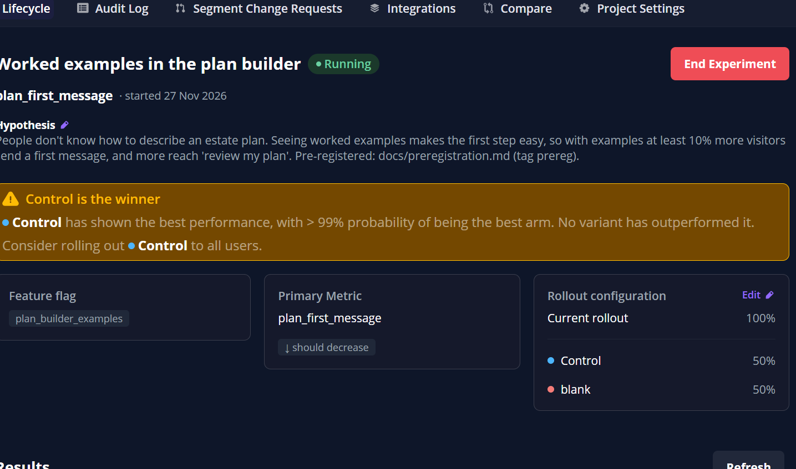
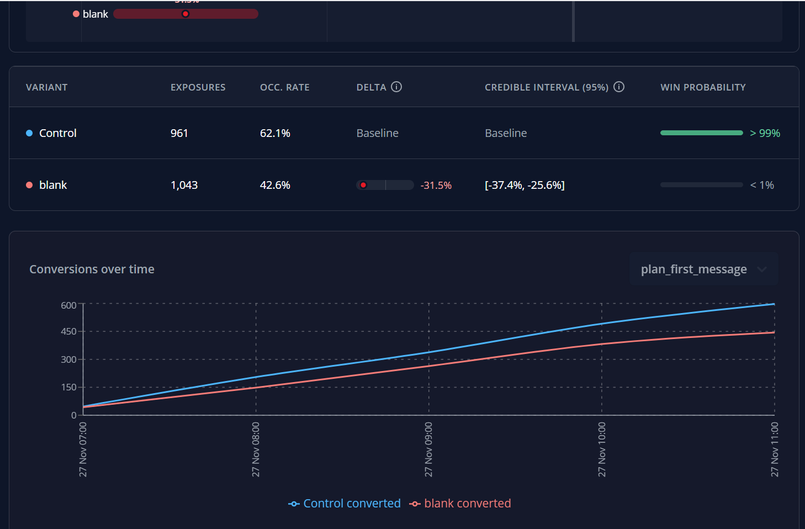
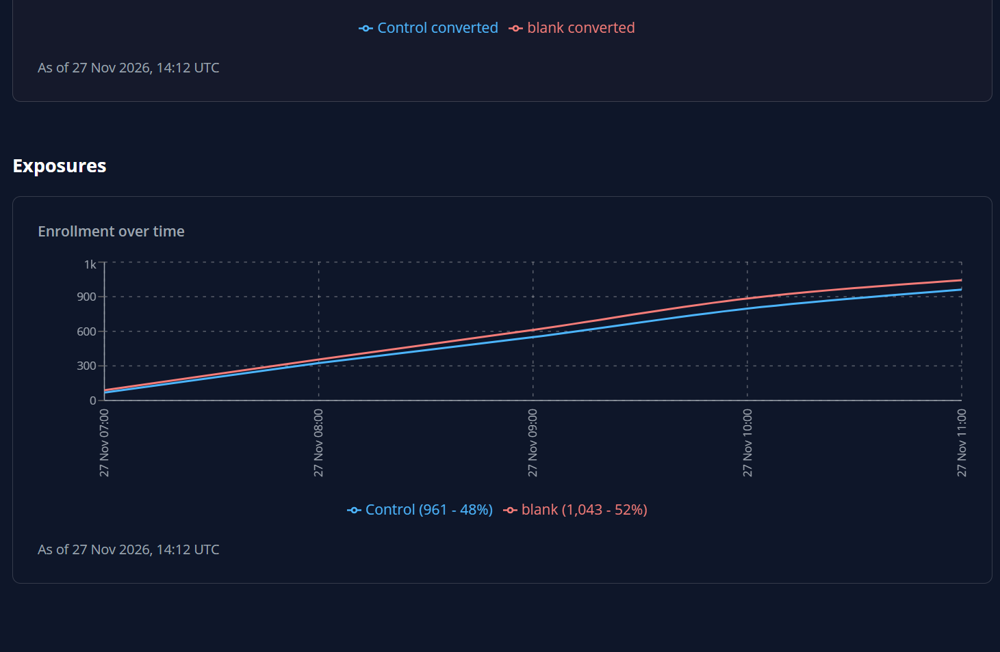

# Results: do worked examples help people start a will?

> **Status: interim, Fri 27 Nov 2026, 14:12 UTC (16:12 SAST).** The Production experiment stops at the
> pre-registered time, **Sat 28 Nov 14:00 SAST**; this page is finalised then. Nothing in the
> [pre-registration](preregistration.md) (tag `prereg`, commit `03e199c`) has changed.

Three experiments, kept apart and never added together:

| | Environment | Visitors | Purpose |
|---|---|---|---|
| [A/A check](#1-aa-check-is-the-pipeline-fair) | Development | 400 **simulated** | Prove the pipeline is fair: no false winner |
| [Simulation](#2-simulation-does-the-pipeline-find-a-known-effect) | Simulation | 2,004 **simulated** | Prove the pipeline finds a known effect |
| [Production](#3-production-real-visitors) | Production | real people | The real question |

## 1. A/A check: is the pipeline fair?

Two identical screens behind a flag (`aa_check`: `control` and `twin`). **Passed** on run 2 (experiment 791): 400
of 400 visitors counted, split 213 / 187 (sample ratio p = 0.19), Flagsmith's event count matched the simulator's
own log exactly (209 first messages), and no false winner (lift +3.3%, 95% interval −16.2% to +22.8%, chance to
win 63%). Run 1 failed and caught a real bug in the simulator first. Full write-up: [results/aa-check.md](results/aa-check.md).

## 2. Simulation: does the pipeline find a known effect?

**Simulated data, not people.** 2,000 simulated visitors ran in real browsers (Playwright) against the deployed
Simulation site, from GitHub Actions run 45960124675 (27 Nov, 07:41–11:41 UTC, 0 errors, 0 lost flushes), plus 4
warm-up visitors. Flagsmith experiment 778. Snapshot:
[results/sim-2026-11-27T14-12-28Z.json](results/sim-2026-11-27T14-12-28Z.json). Run logs:
[a](../scripts/simulate/runs/2026-11-27T07-41-29-303Z.json), [b](../scripts/simulate/runs/2026-11-27T07-41-32-694Z.json).

| Metric | `control` (examples) | `blank` (no examples) | blank vs control (Flagsmith) | 95% credible interval | Chance blank beats control |
|---|---|---|---|---|---|
| Visitors (exposures) | 961 | 1,043 | split 48 / 52, SRM p = 0.067 (ok) | | |
| **`plan_first_message`** (primary) | **62.1%** | 42.6% | **−31.5%** | −37.4% to −25.6% | < 1% |
| `plan_reviewed` | 35.3% | 26.0% | −26.3% | −36.2% to −16.5% | < 1% |
| `plan_signed` | 23.7% | 19.0% | −20.0% | −33.5% to −6.5% | 0.2% |
| `plan_message` per visitor (guardrail) | 1.23 | 0.90 | −26.6% | −34.3% to −19.0% | (lower, so the guardrail holds) |

Put the other way round: with examples, **46% more** simulated visitors wrote a first message (62.1% vs 42.6%).
Flagsmith's verdict: **"Control is the winner"**, with a > 99% chance to be best.

**Against the decision rule:** control's chance to be best is ≥ 95%, so the rule says **keep `control`**.

**Does it find the effect we put in?** The simulator has a known effect built into it, published before it ran
([simulation.md](simulation.md#what-these-numbers-imply-so-the-results-can-be-checked-against-them)). Every one of
the four true effects falls inside Flagsmith's 95% interval:

| Metric | Built-in effect (blank vs control) | Measured | Inside the interval? |
|---|---|---|---|
| `plan_first_message` | −28.0% (62.5% vs 45.0%) | −31.5% | yes |
| `plan_reviewed` | −23.5% | −26.3% | yes |
| `plan_signed` | −20.1% | −20.0% | yes |
| `plan_message` per visitor | −24.4% | −26.6% | yes |

So the flag, the split, the exposures, the events, the metrics and Flagsmith's statistics all work together and
recover a real difference of this size from about 1,000 visitors per version. **This is an effect we put in, not a
finding about people.**

Screenshots of Flagsmith (simulated data, 27 Nov 14:12 UTC):

| | |
|---|---|
|  |  |
|  |  |

A note on Flagsmith's label "↓ should decrease" next to the primary metric: it is the direction we set for the
variation under test. We predicted that taking the examples away (`blank`) would *lower* first messages. It did.

## 3. Production: real visitors

Flagsmith experiment 780, started Fri 27 Nov 07:28:21 UTC (09:28 SAST), stops Sat 28 Nov 12:00 UTC (14:00 SAST).
Live site: <https://heirloom-toggle-wars.vercel.app/try>.

**Interim (Fri 14:12 UTC): 1 real visitor, collecting data.** Snapshot:
[results/prod-2026-11-27T14-12-39Z.json](results/prod-2026-11-27T14-12-39Z.json). Flagsmith shows results from 50
identities and 5 conversions per version; the pre-registered target was 150 per version. Real visitors were not
found in time for a 28.5-hour run, so this experiment will most likely end without enough data. If so, the
pre-registered rule calls it inconclusive and keeps `control`, and we say so.

<!-- FINAL (Sat 28 Nov after 14:00 SAST): the final numbers, the decision, the stop time, the snapshot link. -->

## 4. The decision

| Experiment | Reading | Rule says |
|---|---|---|
| Simulation (simulated) | control > 99% best | keep `control` |
| Production (real) | not enough data yet | (decided at the stop) |

`control` (worked examples) is what every visitor sees outside the experiment. At the stop, the experiment is ended in
Flagsmith and `plan_builder_examples` is set so everyone gets `control`: no redeploy.

<!-- FINAL: when the winner was shipped, and a screenshot of the live site afterwards. -->

## 5. What we'd do next

- **Get real visitors.** Run the same experiment for two weeks with Heirloom's own users and a share push, to the
  pre-registered 150 per version. The pipeline is proven twice over (no false winner, and a known effect found).
- **Test which examples.** If examples help people start, the next question is which ones: everyday wishes ("R1,500 a
  month for Lerato's books") against bigger ones (the house, the car), as a three-way multivariate test.
- **Watch the guardrail on real people.** In the simulation, fewer messages came with fewer starters. With people,
  a version could raise first messages and also cause confusion (more messages per plan); the guardrail is there to
  catch that.

## Where every number comes from

`scripts/flagsmith/results.ts <dev|sim|prod|aa>` refreshes an experiment in Flagsmith's API, prints the table above
and saves the raw response to `docs/results/`. It also computes its own interval, expected loss and sample-ratio
test, as a check on Flagsmith's figures: the lifts match exactly, and the interval ends agree to within 1.2 points.
