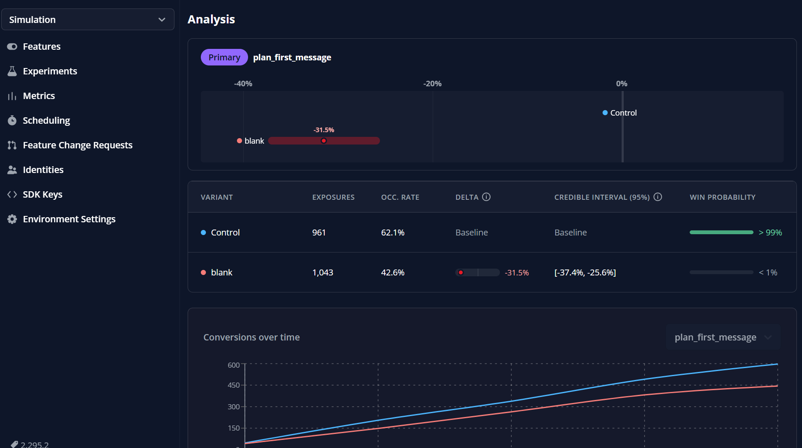
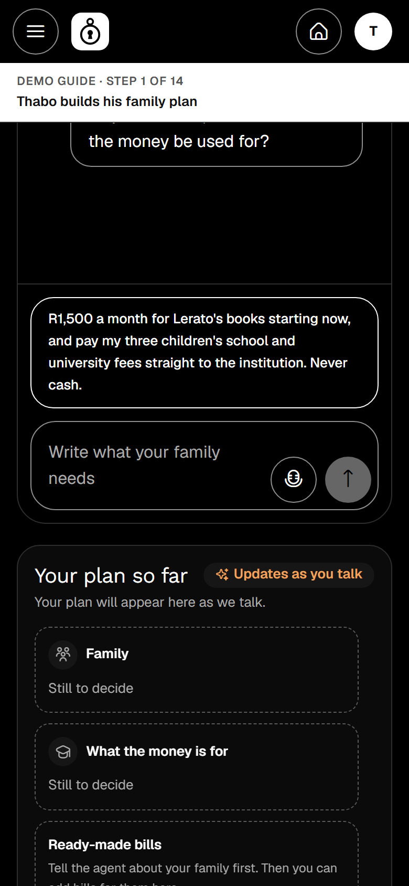
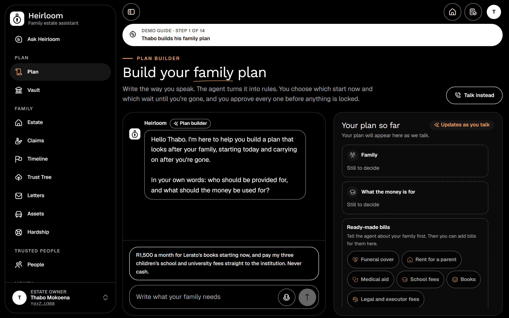

# Results: do worked examples help people start a will?

> **Status: final, Sat 28 Nov 2026.** Both experiments are completed in Flagsmith and `control` is shipped to everyone
> through the flag. Nothing in the [pre-registration](preregistration.md) (tag `prereg`, commit `03e199c`) has
> changed; the one deviation (the experiments were ended 2 h 19 min after the pre-registered stop, with no new data in
> between) is [below](#deviation-the-stop-was-late).

**In one paragraph.** We asked whether worked examples help people write the first sentence of an estate plan. We
first proved the measurement is fair (an A/A check: no false winner) and that it finds a real difference when one
exists (a simulation with a known, built-in effect: found, and Flagsmith's counts match the simulator's own logs
exactly). The real-visitor experiment then ran for 28.5 hours but reached only 1 real visitor, so it **cannot answer
the question about people**; by the pre-registered rule it is inconclusive, and the safer default, `control` (with
examples), stays and is shipped. The question about people is still open, and the pipeline to answer it is ready.

Three experiments, kept apart and never added together:

| | Environment | Visitors | Purpose |
|---|---|---|---|
| [A/A check](#1-aa-check-is-the-pipeline-fair) | Development | 400 **simulated** | Prove the pipeline is fair: no false winner |
| [Simulation](#2-simulation-does-the-pipeline-find-a-known-effect) | Simulation | 2,004 **simulated** | Prove the pipeline finds a known effect |
| [Production](#3-production-real-visitors) | Production | real people | The real question |

## 1. A/A check: is the pipeline fair?

Two identical screens behind a flag (`aa_check`: `control` and `twin`). **Passed** on run 2 (experiment 791): 400
of 400 visitors counted, split 213 / 187 (sample ratio p = 0.19), Flagsmith's event count matched the simulator's
own log exactly (209 first messages), and no false winner (lift +3.3%, 95% interval −16.2% to +22.8%, chance to
win 63%). Run 1 failed and caught a real bug in the simulator first. Full write-up: [results/aa-check.md](results/aa-check.md).

## 2. Simulation: does the pipeline find a known effect?

**Simulated data, not people.** 2,000 simulated visitors ran in real browsers (Playwright) against the deployed
Simulation site, from GitHub Actions run
[45960124675](https://github.com/TUMO-MOGAME/heirloom-toggle-wars/actions/runs/45960124675) (27 Nov, 07:41–11:41
UTC, 0 errors, 0 lost flushes), plus 3 warm-up visitors and 1 exposure we can't trace to a simulator log (see the
check below). Flagsmith experiment 778, completed Sat 28 Nov 14:19 UTC with `control` rolled out. Final snapshot:
[results/sim-2026-11-28T14-19-50Z.json](results/sim-2026-11-28T14-19-50Z.json) (identical to the Fri 14:12 UTC
one, [results/sim-2026-11-27T14-12-28Z.json](results/sim-2026-11-27T14-12-28Z.json), which the tables below cite).
Run logs:
[a](../scripts/simulate/runs/2026-11-27T07-41-29-303Z.json), [b](../scripts/simulate/runs/2026-11-27T07-41-32-694Z.json).

| Metric | `control` (examples) | `blank` (no examples) | blank vs control (Flagsmith) | 95% credible interval | Chance blank beats control |
|---|---|---|---|---|---|
| Visitors (exposures) | 961 | 1,043 | split 48 / 52; our chi-squared SRM test p = 0.067, ok (Flagsmith's own SRM p-value came back empty) | | |
| **`plan_first_message`** (primary) | **62.1%** | 42.6% | **−31.5%** | −37.4% to −25.6% | < 1% |
| `plan_reviewed` | 35.3% | 26.0% | −26.3% | −36.2% to −16.5% | < 1% |
| `plan_signed` | 23.7% | 19.0% | −20.0% | −33.5% to −6.5% | 0.2% |
| `plan_message` per visitor (guardrail) | 1.23 | 0.90 | −26.6% | −34.3% to −19.0% | (lower, so the guardrail holds) |

Put the other way round: with examples, **46% more** simulated visitors wrote a first message (62.1% vs 42.6%).
Flagsmith's verdict: **"Control is the winner"**, with a > 99% chance to be best.

**Against the decision rule:** control's chance to be best is ≥ 95%, so the rule says **keep `control`**.

**Does it find the effect we put in?** The simulator has a known effect built into it, published before it ran
([simulation.md](simulation.md#what-these-numbers-imply-so-the-results-can-be-checked-against-them)). Every one of
the four true effects falls inside Flagsmith's 95% interval:

| Metric | Built-in effect (blank vs control) | Measured | Inside the interval? |
|---|---|---|---|
| `plan_first_message` | −28.0% (62.5% vs 45.0%) | −31.5% | yes |
| `plan_reviewed` | −23.5% | −26.3% | yes |
| `plan_signed` | −20.1% | −20.0% | yes |
| `plan_message` per visitor | −24.4% | −26.6% | yes |

So the flag, the split, the exposures, the events, the metrics and Flagsmith's statistics all work together and
recover a real difference of this size from about 1,000 visitors per version. **This is an effect we put in, not a
finding about people.**

Screenshots of Flagsmith (simulated data, 27 Nov 14:12 UTC):

| | |
|---|---|
|  |  |
|  |  |

### Two checks after the run (read-only, added Sat 28 Nov)

Both use only data we already had: no new traffic, and nothing in the experiment or the
[pre-registration](preregistration.md) changed. Re-run with `python scripts/simulate/checks.py`
([checks.py](../scripts/simulate/checks.py)).

**1. Did Flagsmith receive every event?** The simulator logged what each of its visitors did. Counted up per version,
the log and Flagsmith agree **exactly** on all four metrics:

| Metric | control: simulator log / Flagsmith | blank: simulator log / Flagsmith |
|---|---|---|
| `plan_first_message` | 597 / 597 | 444 / 444 |
| `plan_reviewed` | 339 / 339 | 271 / 271 |
| `plan_signed` | 228 / 228 | 198 / 198 |
| `plan_message` (all messages) | 1,178 / 1,178 | 938 / 938 |

Visitors: 2,003 logged against 2,004 exposures in Flagsmith. 376 simulated visitors left before looking, so the log
doesn't know their version (they sent no events). One exposure has no entry in the simulator's logs; it sent no
events, and it moves the rates by less than 0.1 points.

**2. How many visitors does a test need?** For the first message (baseline about 62%):

| Visitors per version | Smallest drop the test spots (80% power, 5% two-sided) | How often the pre-registered rule finds the simulator's built-in effect (2,000 re-runs) |
|---|---|---|
| 25 | 58.9% | 36% |
| 50 | 43.5% | 54% |
| 150 | 25.7% | 92% |
| 500 | 14.1% | 100% |
| **1,000** | **10.0%** | **100%** |

So 1,000 visitors per version is just enough to spot a 10% change, the pre-registered bar for "worth shipping". At
the pre-registered 150 per version, only large effects (about 26% or more) show reliably. This is also why the
Production experiment, with 1 real visitor, can't answer the question on its own.

A note on Flagsmith's label "↓ should decrease" next to the primary metric: it is the direction we set for the
variation under test. We predicted that taking the examples away (`blank`) would *lower* first messages. It did.

## 3. Production: real visitors

Flagsmith experiment 780, started Fri 27 Nov 07:28:21 UTC (09:28 SAST); pre-registered stop Sat 28 Nov 12:00 UTC
(14:00 SAST); completed in Flagsmith at 14:19:11 UTC with `control` rolled out. Live site:
<https://heirloom-toggle-wars.vercel.app/try>.

**Final: 1 real visitor (in `control`), 0 first messages, nothing in `blank`.** Flagsmith shows a result only from 50
identities and 5 conversions per version, and the pre-registered target was 150 per version. We did not find real
visitors in time for a 28.5-hour run. **By the pre-registered rule this is inconclusive, and `control` stays.** It
says nothing about how people behave, in either direction.

Snapshots: [Fri 14:12 UTC](results/prod-2026-11-27T14-12-39Z.json),
[Sat 08:58 UTC](results/prod-2026-11-28T08-58-55Z.json), [Sat 14:10 UTC](results/prod-2026-11-28T14-10-55Z.json)
(after the stop, before ending: still 1 visitor), [final, Sat 14:19 UTC](results/prod-2026-11-28T14-19-37Z.json).
The pre-registration says we look every 12 hours; the gap between the Fri and Sat looks was about 19 hours. With 1
visitor nothing could have been decided differently.

### Deviation: the stop was late

The pre-registered stop was Sat 28 Nov 12:00 UTC. Both experiments were ended in Flagsmith at 14:19 UTC, 2 h 19 min
late. No data changed in between: Production had the same 1 exposure at 08:58, 14:10 and 14:19 UTC, and the
Simulation's counts were identical before and after (its simulated traffic ended on Fri 11:41 UTC). No result was
read to decide whether to stop, and no number reported here comes from after 12:00 UTC that differs from before it.

## 4. The decision

| Experiment | Result | Rule says |
|---|---|---|
| Simulation (simulated) | control > 99% best | keep `control` |
| Production (real) | 1 visitor: no result | inconclusive, keep `control` |

**Shipped: `control` (worked examples), Sat 28 Nov 14:19 UTC**, by completing both experiments in Flagsmith with
`rollout_decision: control` (`scripts/flagsmith/README.md`, "Complete the experiment"). No code changed and nothing
was redeployed. Checked right after: Flagsmith serves `control` to every identity tried (6 of 6 in Production,
including the ids that got `blank` during the run, and 6 of 6 in Simulation), and 6 fresh browser visits to the live
site (3 phone, 3 desktop) all showed the worked example.

| Phone (390 px) | Desktop |
|---|---|
|  |  |

## 5. What we'd do next

- **Get real visitors.** Run the same experiment for two weeks with Heirloom's own users and a share push, to the
  pre-registered 150 per version. The pipeline is proven twice over (no false winner, and a known effect found).
- **Test which examples.** If examples help people start, the next question is which ones: everyday wishes ("R1,500 a
  month for Lerato's books") against bigger ones (the house, the car), as a three-way multivariate test.
- **Watch the guardrail on real people.** In the simulation, fewer messages came with fewer starters. With people,
  a version could raise first messages and also cause confusion (more messages per plan); the guardrail is there to
  catch that.

## Where every number comes from

`scripts/flagsmith/results.ts <dev|sim|prod|aa>` refreshes an experiment in Flagsmith's API, prints the table above
and saves the raw response to `docs/results/`. It also computes its own interval, expected loss and sample-ratio
test, as a check on Flagsmith's figures: the lifts match exactly, and the interval ends agree to within 1.2 points.
